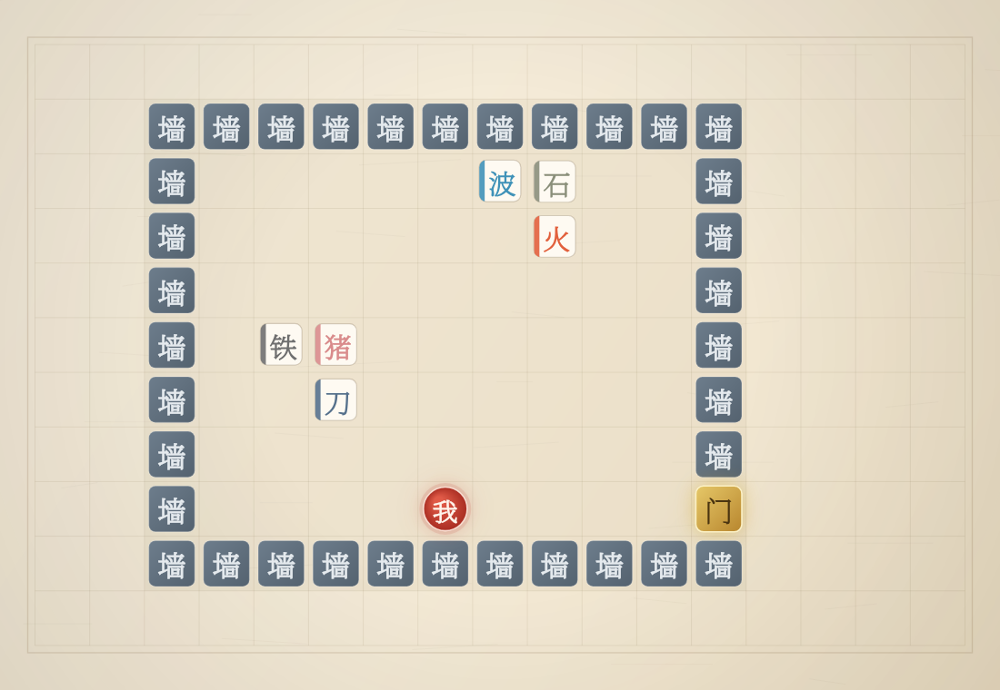
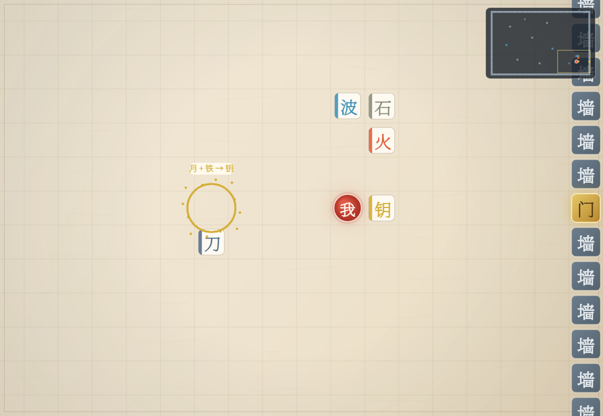

# 我推字 · 文字解谜

一个**纯文字**的网页小游戏：你控制字符「我」，推动场景中的各种字，
按策划案里的反应规则合成 / 销毁字符，最终推「钥」撞「门」开门通关，或者破墙而出。

玩法与规则来自 `文字游戏/策划demo.docx`（含 **2026.11.18 新增内容**）：
「墙」围成长方形，只在右墙留一个「门」；「我」可以推动除「墙」「门」以外的字；两字相撞按规则反应。

> 地图坐标、关键坐标点、通关路线换算等详见 → [地图坐标系.md](地图坐标系.md)
> **想自己设置各种文字的位置？** → [关卡编辑说明.md](关卡编辑说明.md)（改 `js/levels.js`，或用游戏内「编辑布局」可视化摆放）

## 开发者：自定义文字位置

- 所有关卡数据集中在 **`js/levels.js`**：每个字一行 `{ type: "刀", x: 193, y: 129 }`，改坐标即可
- 也可以点游戏右上角 **「编辑布局」**：选字/选「墙」→ **左键单击或按住拖动批量放置**，编辑模式下用 **WASD 移动地图** → 保存布局（存本机 localStorage）
  支持设置玩家起点、门、放置额外墙、导出/导入 JSON、还原默认布局
- 详细说明（坐标规则、数据格式、拖动放字/WASD 移动地图、注意事项）见 **[关卡编辑说明.md](关卡编辑说明.md)**

## 超大地图与摄像机

- 地图为 **209×136 格**（约为最初 17×11 关卡的 **150 倍面积 = 10×15**），屏幕一次只能看到约 **17×11 格**
- **摄像机跟随「我」**：移动时镜头平滑跟随；靠近地图边缘时镜头会夹紧，不会露出地图外
- **小地图**：默认关闭，**靠近「目」时才会出现**（显示玩家、门与当前镜头视野）
- 门在右墙 `(206,130)`，玩家起点 `(193,128)`
- **两个关卡**（右上角 `基础关 / 新内容挑战` 按钮切换，最佳步数按关卡分别记录）：
  - **基础关**：门路线（15 步，`月+铁→钥`）或破墙路线（24 步，`刀+波→水+皮` / `水+墙→蔷` → 破墙而出）
  - **新内容挑战**：初始**不给「铁」**，必须用新合成链自己造铁：`穴+谷→容 → 容+火→熔 → 熔+刀→铁 → 月+铁→钥 → 门`（34 步）；同时展示「目」「蚏」等新内容

## 怎么玩

- 用 **WASD / 方向键** 移动，或直接在画布上**滑动**；手机可点右下角方向键
- **按住方向键/手机方向键不放可以连续移动**（速度可调，见下方「移动速度配置」）
- **Z** 撤销一步，**R** 重开
- 新机制：
  - **蚏**：以诞生点为中心随机移动（半径 5 格），撞墙后返回；被「伐」撞到后停止移动；停止的蚏再被「刀」撞会变成「虫 + 月」
  - **目**：玩家靠近时开启小地图，平时关闭
  - **风**：可以把「火」推动最多三格
- 目标（任一即可通关）：
  1. 按 `月+铁→钥` 合成「钥」，再推「钥」撞「门」；
  2. 用 `皮+石→破`、`破+墙` 破墙，或 `水+墙→蔷`、`火+蔷` 破墙，然后走到围墙外。

### 移动速度配置

按住方向键的连续移动速度在 **`js/main.js` 顶部配置区** 调整：

```js
const INPUT_CONFIG = {
  holdRepeatMs: 120,     // 按住后每隔多少毫秒移动一格（越小越快）
  holdStartDelayMs: 160, // 按下后第一次自动连续移动前的延迟（毫秒）
};
```

按下瞬间会先立即移动一格，之后按 `holdStartDelayMs` 等待、再按 `holdRepeatMs` 的间隔连续移动；
松开按键立即停止。系统自带的键盘自动重复会被忽略，不会出现双倍移动。

### 反应规则（2026.11.18 新版）

| 反应 | 结果 |
| --- | --- |
| 刀 + 菜 | 菜销毁，原地生成「采」（刀保留） |
| 刀 + 相 | 相销毁，原地生成「木」，旁边生成「目」（刀保留） |
| 刀 + 波 | 波销毁，原地生成「水」，旁边生成「皮」（刀保留） |
| 榕 + 刀 | 榕销毁，原地生成「木」，旁边生成「容」 |
| 熔 + 刀 | 熔销毁，原地生成「铁」 |
| 林 + 刀 | 林销毁，生成「木」×2 |
| 森 + 刀 | 森销毁，生成「木」×3 |
| 戈 + 人 | 双方销毁，人的位置生成「伐」 |
| 贝 + 勾 | 双方销毁，勾的位置生成「购」 |
| 破 + 山 | 双方销毁，山的周围生成「石」×3 |
| 风 + 水 | 双方销毁，水的位置生成「波」 |
| 木 + 木 | 双方销毁，生成「林」 |
| 林 + 木 | 双方销毁，生成「森」 |
| 容 + 火 | 双方销毁，生成「熔」 |
| 穴 + 谷 | 双方销毁，生成「容」（仅「谷自下而上撞穴」或「穴自上而下撞谷」生效） |
| 蚏 + 伐 | 伐销毁，蚏停止移动 |
| 蚏（已停止）+ 刀 | 蚏销毁，生成「虫」+「月」（刀保留） |
| 月 + 铁 | 双方销毁，月的位置生成「钥」（可开门） |
| 皮 + 石 | 双方销毁，皮的位置生成「破」 |
| 水 + 墙 | 双方销毁，墙的位置生成「蔷」 |
| 破 + 墙 | 双方销毁，破开围墙 |
| 火 + 蔷 | 双方销毁，破开围墙 |
| 风 + 火 | 「风」把「火」推动最多三格（不是合成） |

> 按新策划案：**删除「肤」字**（原「刀+猪→肤」「刀+肤→月」规则随之移除）。

## 截图

| 初始画面（大地图一角，小地图关闭） | 靠近「目」（小地图开启） | 通关（钥已撞门） |
| --- | --- | --- |
|  |  |  |

> 截图由 `@napi-rs/canvas` 离线渲染引擎生成（见开发说明），非浏览器截图。

## 本地运行

项目是纯静态页面（ES Module，无构建步骤）：

```bash
# 方式一：直接双击 index.html（部分浏览器对本地 ES Module 有限制，建议用方式二）
# 方式二：起一个静态服务器
python -m http.server 8080
# 或者
npx serve .
```

然后访问 `http://localhost:8080/`。

## 测试

```bash
node tests/engine.test.mjs   # 引擎规则 / 关卡可解性 / 摄像机（69 项）
node tests/page.test.mjs     # DOM 桩件页面冒烟测试（71 项）
# 或
npm test
```

## 目录结构

```
worddage/
├── index.html          # 页面结构
├── style.css           # 水墨/宣纸风格样式
├── 地图坐标系.md        # 地图坐标系、关键坐标、通关路线、渲染换算
├── 关卡编辑说明.md      # 如何自己设置各种文字的位置（代码 / 可视化编辑器）
├── js/
│   ├── levels.js       # ★ 关卡配置：所有文字坐标（开发者改这里）
│   ├── engine.js       # 纯逻辑：移动/推字/反应规则/胜负/撤销（可独立测试）
│   ├── art.js          # Canvas 渲染：纸张、字符、特效
│   └── main.js         # 入口：输入、HUD、弹窗、音效、动画循环、布局编辑器
├── tests/
│   ├── engine.test.mjs # 引擎单元测试 + 完整通关路线验证
│   └── page.test.mjs   # DOM/Canvas 桩件下的页面冒烟测试
└── package.json
```

## 技术说明

- 纯前端、零依赖：Canvas 2D + WebAudio 合成音效 + localStorage 记录最佳步数（按关卡分别记录，key 为 `worddage:best:<levelId>`，并兼容旧的 `worddage:best`）
- `engine.js` 不依赖 DOM，可在 Node 中直接跑单元测试；关卡数据统一放在 `js/levels.js`（`DEFAULT_LEVEL` / `CHALLENGE_LEVEL` / `LEVELS`）
- **布局编辑器**：`main.js` 内置「编辑布局」模式，点格子放置/擦除文字或额外「墙」、设置玩家起点与门、保存到 localStorage（`worddage:levels`）、导出/导入 JSON、还原默认；存储的自定义布局在启动时自动应用；色板用事件委托，多行按钮也能正常选中
- `art.js` 负责摄像机：`computeLayout` 按视口约 17×11 格算缩放，`computeCamera` 把「我」放在画面中心并夹在世界边界内；只绘制可见格子；**小地图仅在靠近「目」时绘制**
- 按住连续移动：`main.js` 的 `INPUT_CONFIG` 控制速度；键盘按住状态用逐帧计时驱动，忽略系统 key repeat；手机方向键同样支持按住
- 新机制：`engine.js` 里「蚏」每回合随机移动（以诞生点为中心、半径 `WANDER_RADIUS=5`，撞墙/撞字后反向，`stopped` 后不再移动）；「目」用切比雪夫距离 ≤2 判断小地图开关；「风」推「火」为特殊位移规则
- 关卡数据（地图尺寸、围墙、门、初始字、目标提示）集中在 `engine.js` 的 `DEFAULT_LEVEL` / `CHALLENGE_LEVEL`；`main.js` 的 `switchLevel()` 负责切换关卡与刷新 HUD/摄像机
