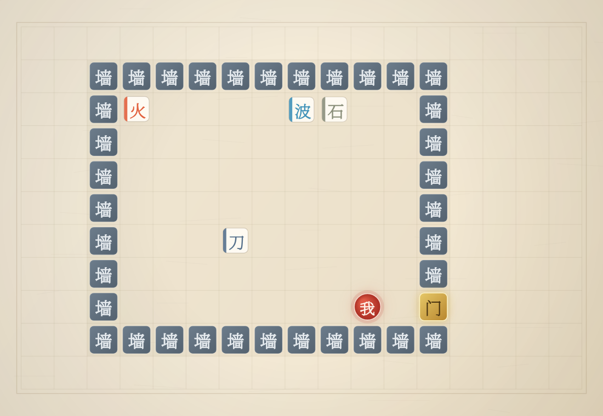

# 我推字 · 文字解谜

一个**纯文字**的网页小游戏：你控制字符「我」，推动场景中的「刀」「猪」「铁」「波」「石」「火」等字，
按策划案里的反应规则合成 / 销毁字符，最终推「钥」撞「门」开门通关，或者破墙而出。

玩法与规则完全来自 `文字游戏/策划demo.docx`：
「墙」围成长方形，只在右墙留一个「门」；「我」可以推动除「墙」「门」以外的字；两字相撞按规则反应。

## 怎么玩

- 用 **WASD / 方向键** 移动，或直接在画布上**滑动**；手机可点右下角方向键
- **Z** 撤销一步，**R** 重开
- 目标（任一即可通关）：
  1. 按 `刀+猪→肤`、`刀+肤→月`、`月+铁→钥` 合成「钥」，再推「钥」撞「门」；
  2. 用 `皮+石→破`、`破+墙` 破墙，或 `水+墙→蔷`、`火+蔷` 破墙，然后走到围墙外。

### 反应规则

| 反应 | 结果 |
| --- | --- |
| 刀 + 猪 | 猪销毁，原地生成「肤」 |
| 刀 + 肤 | 肤销毁，原地生成「月」 |
| 刀 + 波 | 波销毁，原地生成「水」，并在一旁空位生成「皮」 |
| 月 + 铁 | 月与铁销毁，月的位置生成「钥」（钥可开门） |
| 皮 + 石 | 皮与石销毁，皮的位置生成「破」 |
| 破 + 墙 | 破与墙销毁，破开围墙 |
| 水 + 墙 | 水与墙销毁，墙的位置生成「蔷」 |
| 火 + 蔷 | 火与蔷销毁，破开围墙 |

## 截图

| 初始画面 | 合成中（钥已出现） | 通关（门已开） |
| --- | --- | --- |
|  |  |  |

> 截图由 `@napi-rs/canvas` 离线渲染引擎生成（见开发说明），非浏览器截图。

## 本地运行

项目是纯静态页面（ES Module，无构建步骤）：

```bash
# 方式一：直接双击 index.html（部分浏览器对本地 ES Module 有限制，建议用方式二）
# 方式二：起一个静态服务器
python -m http.server 8080
# 或者
npx serve .
```

然后访问 `http://localhost:8080/`。

## 测试

```bash
node tests/engine.test.mjs   # 引擎规则 / 关卡可解性（44 项）
node tests/page.test.mjs     # DOM 桩件页面冒烟测试（18 项）
# 或
npm test
```

## 目录结构

```
worddage/
├── index.html          # 页面结构
├── style.css           # 水墨/宣纸风格样式
├── js/
│   ├── engine.js       # 纯逻辑：移动/推字/反应规则/胜负/撤销（可独立测试）
│   ├── art.js          # Canvas 渲染：纸张、字符、特效
│   └── main.js         # 入口：输入、HUD、弹窗、音效、动画循环
├── tests/
│   ├── engine.test.mjs # 引擎单元测试 + 完整通关路线验证
│   └── page.test.mjs   # DOM/Canvas 桩件下的页面冒烟测试
└── package.json
```

## 技术说明

- 纯前端、零依赖：Canvas 2D + WebAudio 合成音效 + localStorage 记录最佳步数
- `engine.js` 不依赖 DOM，可在 Node 中直接跑单元测试
- 关卡数据（围墙、门、初始字、目标提示）集中在 `engine.js` 的 `DEFAULT_LEVEL`，方便改关卡
